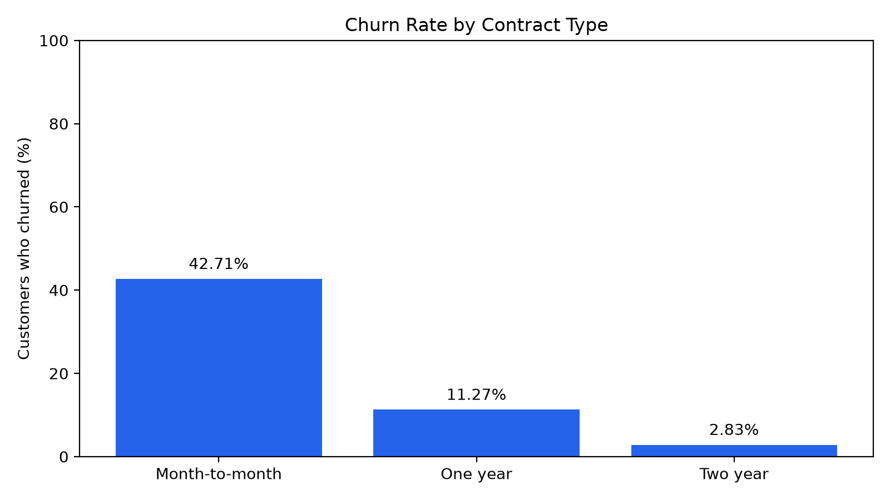

# Telco Customer Churn — Analysis Notes

## Initial dataset inspection

The dataset contains 7,043 records and 21 columns. The inspection found no
completely identical rows. pandas initially reported zero missing values,
but a separate whitespace check found 11 blank values in `TotalCharges`.
The column was read as text. These blanks will be handled during preprocessing.

## Figure 1 — Overall churn distribution

- **Question:** What proportion of customers left?
- **Result:** 1,869 customers (26.54%) left and 5,174 (73.46%) stayed.
- **Implication:** Churn is the minority class. A model that always predicts
  “stayed” would reach 73.46% accuracy while identifying zero churners.
  The model comparison will therefore also consider metrics such as recall
  and F1 for the churn class.

## Figure 2 — Churn rate by contract type

- **Question:** How does the proportion of customers who left vary by contract?
- **Result:** The churn rate was 42.71% for month-to-month contracts
  (1,655 of 3,875), 11.27% for one-year contracts (166 of 1,473), and
  2.83% for two-year contracts (48 of 1,695).
- **Interpretation:** Month-to-month customers had the highest observed churn
  rate in this dataset. The difference shows an association between contract
  type and churn.

## Figure 3 — Tenure and monthly charges by churn status

- **Question:** How do tenure and monthly charges differ between customers
  who stayed and those who left?
- **Result:** Customers who left had a median tenure of 10 months, compared
  with 38 months for customers who stayed. Their median monthly charge was
  79.65, compared with about 64.43 for customers who stayed.
- **Interpretation:** Customers who left had shorter typical tenure and
  higher typical monthly charges in this dataset. These comparisons describe
  associations and do not establish what caused customers to leave.

# Data Preparation

## Handling Missing Values

The `TotalCharges` column was initially stored as text. Whitespace was removed and the column was converted into a numerical data type using `pd.to_numeric()` with `errors="coerce"`.

After conversion, 11 missing values were identified.

**Observation:** The missing records had a tenure of 0 months and all 11 customers had a churn status of No.

**Decision:** All 11 records were retained rather than deleted. Median imputation will be used to handle missing numerical values, with the median learned from the training data only.

## Feature and Target Separation

The target variable (`y`) was created by converting the `Churn` column into binary values:

- No = 0
- Yes = 1

The input features (`X`) were created by removing the `Churn` and `customerID` columns.

The `customerID` column was excluded because it is an identifier and does not provide meaningful predictive information.

## Training and Testing Split

The dataset was divided into training and testing subsets using an 80:20 split.

- Training set: 5,634 records (80%).
- Testing set: 1,409 records (20%).

The split used `random_state=42` to ensure reproducibility and `stratify=y` to maintain similar churn proportions in both subsets.

**Decision:** The test set will remain separate during model training and tuning. It will only be used for final model evaluation to assess performance on unseen data.

## Preprocessing Decisions

The following preprocessing techniques were selected for the machine learning algorithms:

- **Median Imputation:** Missing numerical values will be replaced using the median calculated from the training data.
- **One-Hot Encoding:** Categorical features will be converted into numerical representations using `OneHotEncoder(handle_unknown="ignore")`.
- **Feature Scaling:** `StandardScaler` will be applied to numerical features for KNN and Logistic Regression.
- **Random Forest:** The same imputation and categorical encoding will be applied, but numerical scaling will not be required.
- **SeniorCitizen:** Although stored as a numerical value, this feature will be treated as a binary categorical variable.

All preprocessing operations will be included inside the individual model pipelines during model development. This ensures that preprocessing parameters are learned only from the training portion of each validation fold, helping to prevent data leakage.

## Data Preprocessing Summary

The dataset was prepared for machine learning by converting `TotalCharges` into a numerical format, investigating missing values, separating input features from the target variable and creating a reproducible training and testing split.

All 7,043 records were retained. The preprocessing strategy was also established for KNN, Logistic Regression and Random Forest models, ready for implementation during the next stage.
