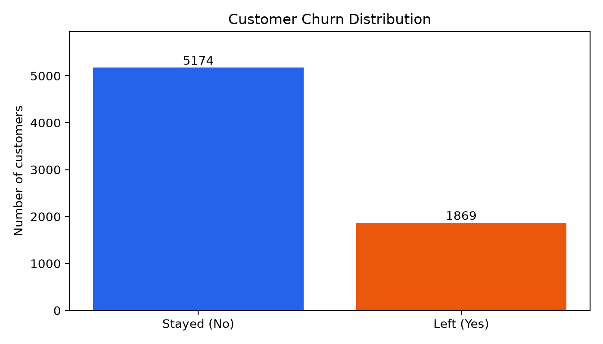
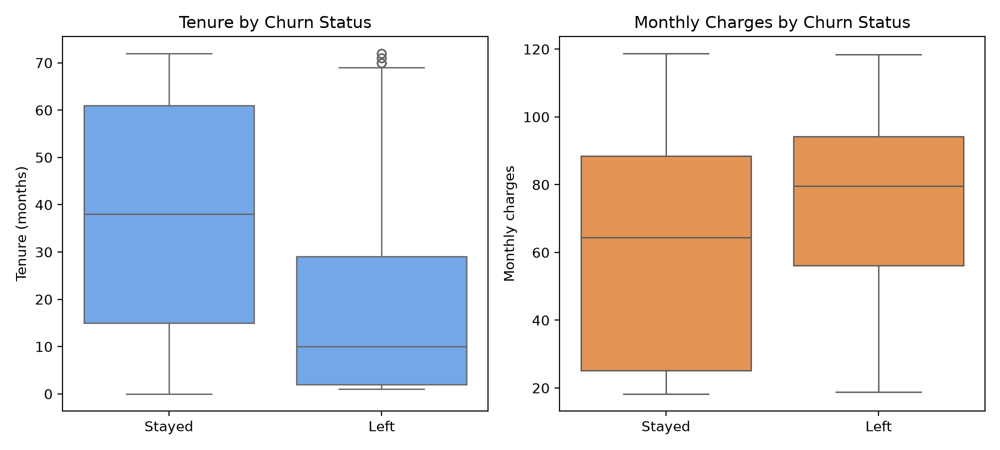

# Telco Customer Churn — Analysis Notes

## Initial dataset inspection

The dataset contains 7,043 records and 21 columns. The inspection found no
completely identical rows. pandas initially reported zero missing values,
but a separate whitespace check found 11 blank values in `TotalCharges`.
The column was read as text. These blanks will be handled during preprocessing.

## Figure 1 — Overall churn distribution

- **Question:** What proportion of customers left?
- **Result:** 1,869 customers (26.54%) left and 5,174 (73.46%) stayed.
- **Implication:** Churn is the minority class. A model that always predicts
  “stayed” would reach 73.46% accuracy while identifying zero churners.
  The model comparison will therefore also consider metrics such as recall
  and F1 for the churn class.

## Figure 2 — Churn rate by contract type

- **Question:** How does the proportion of customers who left vary by contract?
- **Result:** The churn rate was 42.71% for month-to-month contracts
  (1,655 of 3,875), 11.27% for one-year contracts (166 of 1,473), and
  2.83% for two-year contracts (48 of 1,695).
- **Interpretation:** Month-to-month customers had the highest observed churn
  rate in this dataset. The difference shows an association between contract
  type and churn.

## Figure 3 — Tenure and monthly charges by churn status

- **Question:** How do tenure and monthly charges differ between customers
  who stayed and those who left?
- **Result:** Customers who left had a median tenure of 10 months, compared
  with 38 months for customers who stayed. Their median monthly charge was
  79.65, compared with about 64.43 for customers who stayed.
- **Interpretation:** Customers who left had shorter typical tenure and
  higher typical monthly charges in this dataset. These comparisons describe
  associations and do not establish what caused customers to leave.

